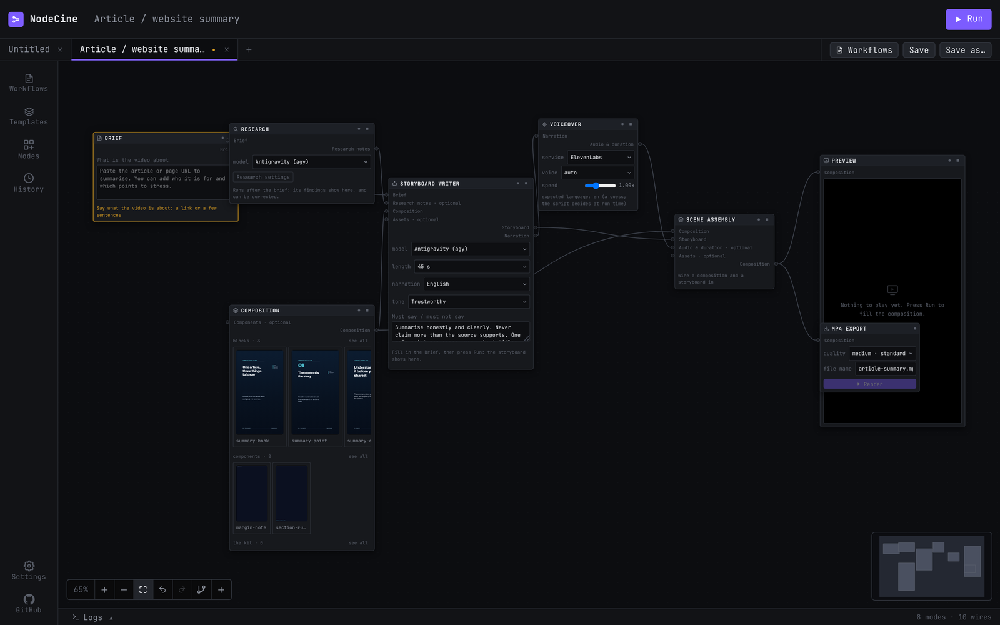

# NodeCine

An open-source, node-based video studio. Build reusable workflows for research, scripts, voice-over, recorded footage and HTML compositions, then preview and export videos locally.



**Status: early alpha.** The app includes 16 nodes and a HyperFrames engine. Workflows and provider integrations are still evolving; keep backups of work you care about. The interface supports English and Vietnamese.

## Requirements

- Node.js 22.12 or newer and npm. `.nvmrc` selects Node 22.
- FFmpeg and ffprobe on your PATH for audio processing and video export.
- A browser. `npm ci` also installs Puppeteer's browser for rendering; allow the dependency and browser downloads to finish.
- macOS is the current development platform. The default voice, Kokoro, runs on every platform. Windows support has not been verified; optional setup scripts require Bash.

## Quick start

From your cloned repository:

```sh
nvm use                 # optional, if you use nvm
npm ci
npm run dev
```

Open <http://127.0.0.1:3000>. No API key is required to open the Studio or try the built-in composition. On macOS, FFmpeg can be installed with `brew install ffmpeg`; on Ubuntu, use `sudo apt-get install ffmpeg`.

On Windows PowerShell, use `npm.cmd` if execution policy blocks `npm.ps1`:

```powershell
npm.cmd ci
npm.cmd run dev
```

Install FFmpeg and ffprobe on PATH before processing media. If using
`NODECINE_FFMPEG_BIN` in `.env.local`, point it to `ffmpeg.exe`; `ffprobe.exe`
must be in the same directory.

For a local production build:

```sh
npm run build
npm start
```

Both launch commands bind to `127.0.0.1`. This is a single-user local application: its APIs have no authentication. Keep it off public interfaces and only import workflows and composition code you trust. Local execution can use your files and configured provider credentials. Hosted providers send the requested content to their services.

## Try your first workflow

1. Create a workflow from the Workflows panel.
2. Open the node library and double-click **Composition** and **Preview** to add them to the canvas.
3. Connect the Composition output to the Preview composition input.
4. Press **Run** (or **Chạy Luồng**). The built-in portrait composition plays a five-second title animation with no model or voice provider.
5. Add **MP4 Export**, connect the same Composition output, then press **Render** on that node. Export is an explicit action; pressing Run alone does not render an MP4.

Add a **Fill** node between Composition and Preview to set composition variables such as `title` and `accent`. More involved workflows can use Brief, Research, Storyboard Writer, Assets, TTS, Transcribe, Footage, Rough Cut, Matte, Coverage and Assemble. The ports indicate which outputs can connect.

Download workflow JSON from the Workflows panel to keep a backup. Referenced uploaded media is stored separately under `.nodecine/assets`; keep that directory with your backups.

The **Templates** button opens a gallery dialog, separate from the Workflows sidebar. Select a template card to open a new unsaved draft; editing or saving that draft does not change the template. Bundled templates ship with the app under `templates/`; personal workflows remain under `.nodecine/workflows`.

## The workflow agent

Each workflow has its own agent in a chat column right of the canvas (**Agent**, or Ctrl+I). It thinks with the workflow's model, chosen at the top of the panel, and edits the canvas for you: adding and wiring nodes, setting them up, running the workflow. Ctrl+Z undoes what it did. Select a node, or press its agent button, to talk about that node.

To make videos like one you already have, attach it with **Sample video**, or paste a link with **Link** (YouTube, TikTok, Facebook or a video file on the web; fetched with `yt-dlp`). The video is read by [rea-video](https://github.com/JuneYaooo/rea-video) (`npm run setup:rea-video`, about 320 MB): its scenes, captions, sound and speech. The agent looks at a still from every scene, sets the workflow's pipeline up for that kind of film, and, when no template looks like it, hands the look to a **kit builder**: a coding-agent session (Claude Code, Codex or Antigravity, whichever the workflow's model is) that writes a new HyperFrames kit in a folder of its own under `.nodecine/kits/`, following `server/contracts/kit/NODECINE-KIT.md`. NodeCine checks the kit and puts it into the Composition node. Use only videos you may use.

## Providers and optional tools

Choose providers in the Studio settings. Install and configure only the providers you want to use.

| Provider                          | Setup                                                                                                                                                                                                                                                    |
| --------------------------------- | -------------------------------------------------------------------------------------------------------------------------------------------------------------------------------------------------------------------------------------------------------- |
| Ollama                            | Run your Ollama server and install the selected model. Default: `llama3.2`; server URL can be overridden in `.env.local`.                                                                                                                                |
| Claude Code / Codex / Antigravity | Install and sign in to the corresponding CLI on this machine. NodeCine detects the executable; optional binary overrides are listed below.                                                                                                               |
| Kokoro                            | The default voice. Its model (132 MB) downloads by itself the first time it reads; `npm run setup:kokoro` fetches it ahead of time. Runs on Node, no Python. English, Spanish, French, Hindi, Italian, Japanese, Portuguese, Chinese.                    |
| VieNeu                            | `npm run setup:vieneu` installs the Vietnamese voices (needs `uv`; about 1.2 GB with the model).                                                                                                                                                         |
| OmniVoice                         | `npm run setup:omnivoice` installs the voice-cloning add-on (needs `uv`; about 8 GB). Voices are samples in `.nodecine/voices/`: a 3–10 second recording and a `.txt` of the same name with its exact words. Use only your own voice or one you may use. |
| ElevenLabs                        | Set `ELEVENLABS_API_KEY` in `.env.local`.                                                                                                                                                                                                                |
| Vbee                              | Set `VBEE_TOKEN` and `VBEE_APP_ID` in `.env.local`.                                                                                                                                                                                                      |

Copy `.env.example` to `.env.local` when using service credentials, uncomment the entries you need, and restart the app. The sample includes ElevenLabs and Vbee credentials, plus optional `ANTHROPIC_API_KEY` and `OPENAI_API_KEY` entries recognized by the Claude Code and Codex adapters. CLI providers can use an existing CLI login instead. Ollama, Kokoro, VieNeu and OmniVoice need no API keys. Never put credentials in workflow JSON.

The current Assets node finds pictures on linked or searched web pages through the selected model. It does not call Pexels or Pixabay. `PEXELS_API_KEY` and `PIXABAY_API_KEY` belonged to the retired Stock Media node and have no effect in this version.

Optional setup commands:

```sh
npm run setup:align     # requires uv; installs stable-ts in a local Python environment
npm run setup:matte     # downloads the matting model into .nodecine/models
npm run setup:kokoro    # default voice model (132 MB), otherwise fetched on first use
npm run setup:vieneu    # requires uv; Vietnamese voices
npm run setup:omnivoice # requires uv; voice cloning add-on, about 8 GB
npm run setup:rea-video # requires git and uv; reads sample videos for the workflow agent
```

Alignment downloads a Whisper model on first use. These tools and their downloads are not needed for the starter preview. Models and external services have their own terms.

<details>
<summary>Advanced environment overrides</summary>

Most installations can use the defaults. Add an override to `.env.local` only when your setup needs it, then restart the app. The `NODECINE_` prefix identifies app-specific configuration; these variables are not API keys.

| Variable                                                                             | Purpose / default                                                                     |
| ------------------------------------------------------------------------------------ | ------------------------------------------------------------------------------------- |
| `NODECINE_CLAUDE_BIN`, `NODECINE_CODEX_BIN`, `NODECINE_AGY_BIN`                      | Override the executable normally detected on PATH.                                    |
| `NODECINE_FFMPEG_BIN`                                                                | FFmpeg executable path; ffprobe must be beside it.                                    |
| `NODECINE_OLLAMA_URL`                                                                | Ollama server; default `http://127.0.0.1:11434`.                                      |
| `NODECINE_KOKORO_DIR`                                                                | Kokoro model folder; default `.nodecine/tools/kokoro/kokoro-int8-multi-lang-v1_0`.    |
| `NODECINE_VIENEU_DIR`, `NODECINE_OMNIVOICE_DIR`                                      | A Python environment that already holds the voice; default `.nodecine/tools/<voice>`. |
| `NODECINE_VOICES_DIR`                                                                | OmniVoice samples; default `.nodecine/voices`.                                        |
| `NODECINE_ALIGN_PYTHON`                                                              | Alignment interpreter; default `.nodecine/tools/stable-ts/bin/python`.                |
| `NODECINE_MATTE_MODEL`                                                               | Matting model; default `.nodecine/models/rvm_resnet50_fp32.onnx`.                     |
| `NODECINE_TMP_DIR`                                                                   | Temporary media; default `.nodecine/tmp`.                                             |
| `NODECINE_ASSETS_DIR`                                                                | Uploaded assets; default `.nodecine/assets`.                                          |
| `NODECINE_WORKFLOWS_DIR`                                                             | Saved workflows; default `.nodecine/workflows`.                                       |
| `NODECINE_JOBS_DIR`                                                                  | Job history; default `.nodecine/jobs`.                                                |
| `NODECINE_CACHE_DIR`                                                                 | Cached results; default `.nodecine/cache`.                                            |
| `NODECINE_MAX_PARALLEL_JOBS`                                                         | Concurrent jobs; default `2`.                                                         |
| `NODECINE_CLAUDE_TIMEOUT_MS`, `NODECINE_CODEX_TIMEOUT_MS`, `NODECINE_AGY_TIMEOUT_MS` | CLI request timeout in milliseconds; default `600000` (10 minutes).                   |

</details>

## Local data

All default server data lives under the ignored `.nodecine/` directory: workflows, assets, jobs, caches, temporary media, models and tools. Browser state also lives in local storage. Do not commit `.env` files, credentials, personal footage or generated output. `.env.example` contains placeholders only.

## Development and checks

```sh
npm run typecheck
npm run lint
npm test
npm run build
```

GitHub Actions runs these checks on Linux with Node 22 and FFmpeg. The render, transcription, local voice and live Vbee suites are opt-in (`NODECINE_MANUAL_RENDER=1`, `NODECINE_MANUAL_TRANSCRIBE=1`, `NODECINE_MANUAL_VOICES=1`, `NODECINE_MANUAL_VBEE=1`) and need their external tools or credentials. CI does not exercise every provider or perform a full video render.

If a build stalls before compilation in a network-restricted environment, try `NEXT_TELEMETRY_DISABLED=1 npm run build`.

When reporting an issue, include your OS, Node version, reproduction steps and sanitized logs. Remove private prompts, paths, media and credentials.

## Layout

- `core/` — how nodes run: the graph, the executor, pins, signatures and kept results, migrations, and the empty registries. It knows nothing about video.
- `contracts/` — what video nodes agree on: port types and their payloads, the composition an engine previews and renders, the engine and provider interfaces. Registers into `core/` at startup.
- `capsules/` — everything that plugs in, one folder each and the same rules for all: `nodes/` (the steps of a workflow), `engines/` (HyperFrames), `providers/` (models and voices). A capsule knows the Studio only through `sdk/`: the host a node body is handed and the kit it draws with. `migrations.ts` and `retired.json` carry old workflows across removed and renamed node types.
- `templates/` — the workflow templates the gallery opens, one folder each (`article-summary/`): the `workflow.json` it opens, its `thumbnail.svg`, a `template.manifest.json` with what the card shows, and the build script that writes the workflow from its scene designs. `npm run templates:discover` turns those folders into the list the server reads, so adding a template is adding a folder.
- `server/` — the runtime host: the job queue, result store, code fingerprints, workflow files; it knows no capsule. `server/contracts/` is the server half of `contracts/` and where the server is assembled: it registers the capsules, and holds the model, voice and render services, audio tools, the workflow tag in an MP4 and the run history.
- `app/`, `components/`, `store/`, `lib/` — the Studio.

`npm run capsules:check` enforces the walls between them; `npm run capsules:prepare` regenerates the registries and runs it.

## License

NodeCine source is licensed under [MIT](LICENSE). Third-party dependencies, models and assets retain their own licenses. Bundled JetBrains Mono fonts use the [SIL Open Font License](public/fonts/OFL.txt); GSAP is distributed under its own license, not NodeCine's MIT license.
